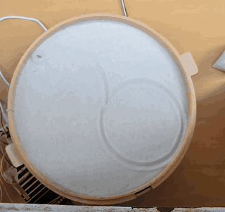
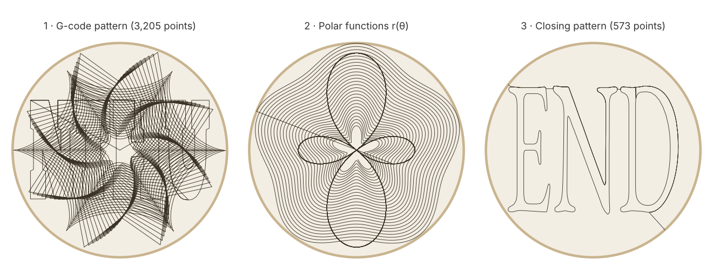

# Sand Drawing Robot — ESP32 Polar Sand Table


A magnet on a two-link arm hidden under a tray of sand drags a steel ball across the surface to draw. The ESP32 firmware homes and calibrates both stepper motors, then plays back a pre-generated G-code pattern, draws two parametric polar curves, and finishes with an "END" pattern. Afterwards it accepts target coordinates over serial.

<p align="center">
  
  <br><sub>Time-lapse of a full run (sped up).</sub>
</p>

Individual final project for **Design and Implementation of Robot** at National Tsing Hua University (Fall 2023). I wrote all the firmware in this repository; the header comment in `sand_table.ino` notes the one function where I referenced a classmate's approach.

## Highlights

- **Closed-form inverse kinematics** for an equal-length two-link arm, mapping any (x, y) on the 276 mm disc to absolute step targets for both motors.
- **Straight lines from a rotary mechanism.** Segments longer than 0.5 mm are split recursively at their midpoint, so the ball traces straight lines instead of arcs.
- **Shortest-way wrapping.** Every target is shifted by whole revolutions so neither motor turns more than half a revolution per move. This removed sudden full-circle sweeps between neighbouring points.
- **Self-calibration.** Each run homes both joints against their sensors and measures the actual steps per revolution over three laps before drawing.

## How it draws

<p align="center">
  
  <br><sub>The three drawing passes, rendered from the firmware's own point arrays and equations by <code>tools/plot_toolpaths.py</code>.</sub>
</p>

| Pass | Source | What happens |
|------|--------|--------------|
| 1 | `gcode.h` (3,205 points) | Pre-generated toolpath converted from G-code, replayed point to point with straight-line interpolation. |
| 2 | `runfunc()` | Spiral `r = 1.3θ + 20 sin 5θ` out to the rim, then rose `r = 50 − 200 cos 2θ` back in. |
| 3 | `endcode.h` (573 points) | Closing "END" pattern after re-homing. |
| — | `handin()` | Interactive mode: type `x, y` over serial and the ball moves there in a straight line, or the board replies `OUT OF RANGE`. |

## Kinematics

Both links are the same length, *L* = 138 mm, so the reach is *R* = 2*L* = 276 mm. With the inner and outer joints at absolute angles *a* and *b*, the ball sits at

$$
\mathbf{p} = L\,(\cos a + \cos b,\ \sin a + \sin b) = R\cos\!\left(\tfrac{b-a}{2}\right)\left(\cos\tfrac{a+b}{2},\ \sin\tfrac{a+b}{2}\right)
$$

so a target in polar form (*r*, *θ*) is reached with

$$
\alpha = \arccos\frac{r}{R}, \qquad a = \theta - \alpha, \qquad b = \theta + \alpha .
$$

`rtheta_to_pls()` converts *a* and *b* to step counts using the calibrated steps per revolution, keeping the arm in the same elbow configuration. `PLStoMove()` then adds or subtracts whole revolutions so each motor takes the short way round, and drives both motors together with `MultiStepper` so they arrive at the same time.

## Problems I hit

| Symptom | Cause | Fix |
|---------|-------|-----|
| Between two neighbouring points the arm sometimes swept a full circle. | Joint angles wrap at ±π, so a tiny move across the seam looked like a 2π move. | Wrap each step target into ±half a revolution of the current position. |
| Coordinates drifted, especially after passing through the centre. | Not pinned down during the course. The most likely cause is the singularity at *r* → 0: θ is undefined there, so small position errors become large joint jumps and can cost steps. | Re-home between passes. A cleaner fix would be to route paths around a small exclusion zone at the centre. |
| Hard-coded steps per revolution drifted (prototype values ranged from about 1760 to 1800, and differed between joints). | Mechanical variation between the two joints. | `testloop()` measures both on every boot. |

## Hardware

| Part | Notes |
|------|-------|
| ESP32 dev board | Runs everything; serial at 115200 baud |
| 2 × stepper motor + driver | STEP/DIR on GPIO 22/23 (inner) and 16/17 (outer) |
| 2 × homing sensor | GPIO 15 (inner) and 4 (outer), active-low with pull-ups |
| Magnet on the arm tip, steel ball, sand tray | Drawing surface |

## Build and flash

1. Install the **ESP32 board package** and the **AccelStepper** library in the Arduino IDE.
2. Open `firmware/sand_table/sand_table.ino` and upload.
3. Open the serial monitor at 115200 baud. The run starts automatically; afterwards type coordinates such as `0, 138`.

Pin numbers, arm length and homing offset are defined at the top of `setupsand.h`.

## Repository layout

```
firmware/
├── sand_table/      final firmware: sand_table.ino, setupsand.h (kinematics + motion), gcode.h, endcode.h
└── prototypes/      earlier sketches: coordinate conversion, homing, first IK test
tools/plot_toolpaths.py   renders docs/media/toolpaths.png from the firmware sources
docs/media/               demo GIF and toolpath preview
```

## License

MIT. See [LICENSE](LICENSE).
